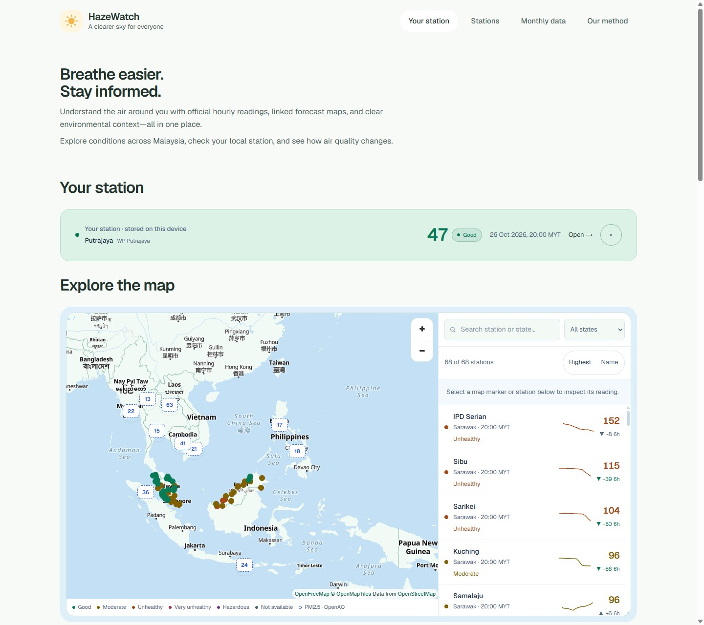

# HazeWatch

### Malaysia’s air quality, on the map.

Find a station, check its latest reading, and see how conditions are changing.

**[Explore the dashboard →](https://hazewatch-drab.vercel.app/)**

*Screenshot of the deployed dashboard. Reading times and freshness are shown in the interface.*

## Why HazeWatch?

Air-quality information is spread across different sources. HazeWatch brings official station readings, locations, and recent trends into one dashboard, making local conditions easier to find and understand.

## Main features

| Feature | What you can do |
|:---|:---|
| **Interactive Malaysia map** | Select a station to see its name, reading, category, and update time in a small popup. |
| **Search & state filters** | Find a location and compare monitoring stations. |
| **National overview** | Check reporting coverage and air-quality categories across Malaysia. |
| **Station history** | Follow recent readings through charts and six-hour comparisons. |
| **Worsening-condition watch** | Identify stations with rising API readings. |
| **Air quality near you** | Opt in to your location to find the closest stations with a current reading. Your position never leaves the browser. |
| **Health guidance** | Plain-language precautions for each API band, tailored for everyone, outdoor workers, school and sport, and people at higher risk. |

Station observations come from **DOE APIMS Malaysia**, with source attribution and timestamps displayed alongside the data.

## Built with

**Next.js · React · TypeScript · Tailwind CSS · Supabase · Vercel**

Interactive mapping powered by **MapLibre GL JS** and **OpenFreeMap**.

---

[Live dashboard](https://hazewatch-drab.vercel.app/) · [Setup & technical reference](docs/SETUP.md)
